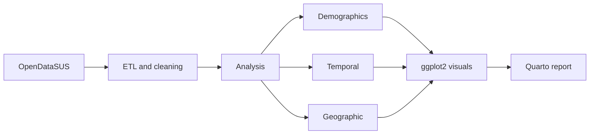

<div align="center">

# 🩺 SRAG Monitor

**From numbers to human stories.**

Five years of COVID-19 data (2020-2024) analyzed to understand its impact on Espírito Santo, Brazil.

<br />

[](#-key-findings)
[](https://www.r-project.org)
[](https://quarto.org)
[](https://ggplot2.tidyverse.org)
[](https://www.icepi.es.gov.br/)

<br />

[About](#-about) · [Approach](#-approach) · [Key findings](#-key-findings) · [Data](#-data-sources) · [Tech stack](#-tech-stack) · [Quick start](#-quick-start) · [Impact](#-real-world-applications)

</div>

<br />

## ◆ About

What started as a routine data analysis assignment became a closer look at the human cost of a global pandemic.

**SRAG Monitor** analyzes five years of Severe Acute Respiratory Syndrome (SRAG) notifications from Espírito Santo, turning raw epidemiological records into insights about how the state went through COVID-19.

> *How did Espírito Santo navigate one of the most challenging periods in modern history?*

It is the **final project** of the Data Analysis Training Program for Health Management, by ICEPi.

| | | |
|---|---|---|
| 📁 **Volume** | 1.2M+ | Nationwide SRAG notifications over 5 years |
| 🗺️ **Scope** | Espírito Santo | State-level analysis with municipal depth |
| ⏰ **Timeline** | 2020 to 2024 | The full evolution of the pandemic |
| 🔬 **Complexity** | Multiple variables | Demographics, geography, and time |

<br />

## ◆ Approach



| Dimension | Question | What was analyzed |
|---|---|---|
| 👥 **Demographics** | Who was affected? | Vulnerability of the elderly, age group shifts, vaccination impact by age, high-risk profiles |
| 📅 **Temporal** | When did the waves occur? | Wave patterns, peaks and recovery, seasonal variation, long-term trends |
| 🗺️ **Geographic** | Where was the impact greatest? | Municipal distribution, healthcare system stress, urban vs rural patterns |

<details>
<summary><b>Data pipeline in detail</b></summary>

<br />

| Step | What happens |
|---|---|
| **Automated ETL** | Download yearly datasets, filter Espírito Santo cases, standardize variable names |
| **Cleaning** | Missing values, date standardization, age group categories, outcome classification |
| **Analysis** | Demographic, temporal, and geographic views of the data |
| **Visualization** | Time series, bar charts, and histograms with ggplot2 |
| **Reporting** | HTML report generated with Quarto |

</details>

<br />

## ◆ Key findings

| Finding | Meaning |
|---|---|
| 🚨 **Peak in March 2021** | Maximum stress on the healthcare system, making emergency capacity planning critical |
| 👴 **60+ most affected** | The elderly were the highest-risk group, which supports targeted vaccination |
| 📉 **Recovery by mid-2023** | The transition to an endemic pattern was complete |
| 💉 **Vaccination effect** | Significant reduction in mortality after the rollout |
| 🎄 **Seasonal patterns** | Peaks around the holiday season point to the need for preventive campaigns |

**The pandemic in four moments**

| Period | Story |
|---|---|
| 🦠 **2020** | The unknown enemy arrives, with limited treatment |
| 💉 **2021** | Variant surge and the start of vaccination |
| 🏥 **2022** | Omicron dominance and living with COVID-19 |
| 📉 **2023-2024** | Sustained low levels, the new normal |

**Age groups:** 60+ had the highest mortality, 40-59 had significant hospitalizations, and 0-17 had fewer severe outcomes.

<br />

## ◆ Data sources

All data comes from **[OpenDataSUS](https://opendatasus.saude.gov.br/)**, Brazil's open health data portal.

| Year | Dataset | Context |
|:-:|---|---|
| **2020** | [SRAG-2020](https://opendatasus.saude.gov.br/dataset/srag-2020) | First wave and initial response |
| **2021** | [SRAG-2021 to 2024](https://opendatasus.saude.gov.br/dataset/srag-2021-a-2024) | Variants and vaccination rollout |
| **2022** | [SRAG-2021 to 2024](https://opendatasus.saude.gov.br/dataset/srag-2021-a-2024) | Omicron and the endemic transition |
| **2023** | [SRAG-2021 to 2024](https://opendatasus.saude.gov.br/dataset/srag-2021-a-2024) | Post-pandemic trends |
| **2024** | [SRAG-2021 to 2024](https://opendatasus.saude.gov.br/dataset/srag-2021-a-2024) | Current status and lessons learned |

📋 [**SRAG data dictionary**](https://www.saude.ba.gov.br/wp-content/uploads/2021/06/Dicionario_de_Dados_SRAG_Hospitalizado_23.03.2021.pdf): variable documentation for hospitalized cases.

<br />

## ◆ Tech stack

| Tool | Role |
|---|---|
| **R** | Statistical computing |
| **Quarto** | Scientific publishing and report generation |
| **ggplot2** | Data visualization |
| **dplyr** | Data manipulation |
| **readr** | Data import |
| **lubridate** | Date handling |
| **tidyr** | Data tidying |
| **knitr** | Dynamic reports |

<br />

## ◆ Quick start

```bash
git clone https://github.com/joaogalimberti/srag-covid19-analysis.git
cd srag-covid19-analysis
```

Open the project in **RStudio** and install the required packages:

```r
install.packages(c("ggplot2", "dplyr", "readr", "lubridate", "tidyr", "quarto"))
```

Then run the analysis and render the Quarto report to view the insights.

<br />

## ◆ Real-world applications

| | Use | Value |
|:-:|---|---|
| 📊 | **Pandemic preparedness** | Planning for future responses |
| 🏥 | **Resource allocation** | Evidence-based decisions |
| 📈 | **Policy evaluation** | Measuring how effective interventions were |
| 🎓 | **Education** | Training material for health data analysis |
| 💡 | **Community awareness** | Transparent communication with the public |

**Who benefits:** health departments, hospital administrators, policy makers, research institutions, and the general public.

<details>
<summary><b>Skills developed</b></summary>

<br />

| Technical | Public health |
|---|---|
| Advanced R programming | Epidemiological analysis |
| ggplot2 visualizations | Health data science |
| Quarto reports | Policy translation |
| Automated ETL pipeline | Science communication |
| Statistical analysis | Population health |

</details>

<br />

## ◆ Principles

| | Principle | Meaning |
|:-:|---|---|
| 💚 | **Humanity first** | Every number represents a person's story |
| 🔬 | **Scientific rigor** | Evidence-based methodology throughout |
| 🌍 | **Public good** | Data serving community health |
| 📖 | **Transparency** | Open data, open methods, open results |

<br />

## ◆ Resources

| Resource | Link |
|---|---|
| **ICEPi**, Health Management Training | [icepi.es.gov.br](https://www.icepi.es.gov.br/) |
| **OpenDataSUS**, Brazil's open health data | [opendatasus.saude.gov.br](https://opendatasus.saude.gov.br/) |
| **R for Data Science** | [r4ds.had.co.nz](https://r4ds.had.co.nz/) |
| **ggplot2 documentation** | [ggplot2.tidyverse.org](https://ggplot2.tidyverse.org/) |

<br />

## ◆ Contributing

Contributions are welcome. Fork the repo, create a branch, and open a pull request:

```bash
git checkout -b feature/enhanced-analysis
git commit -m "feat: add additional demographic analysis"
git push origin feature/enhanced-analysis
```

Good areas to help: new statistical methods and visualizations, municipal-level spatial analysis, documentation and translations, and new use cases.

<br />

<div align="center">

[](mailto:joaogalimberti@gmail.com)
[](https://www.linkedin.com/in/joaogalimberti/)
[](https://github.com/joaogalimberti)

<br />

*When data becomes a lifeline for understanding and prevention.*

</div>
